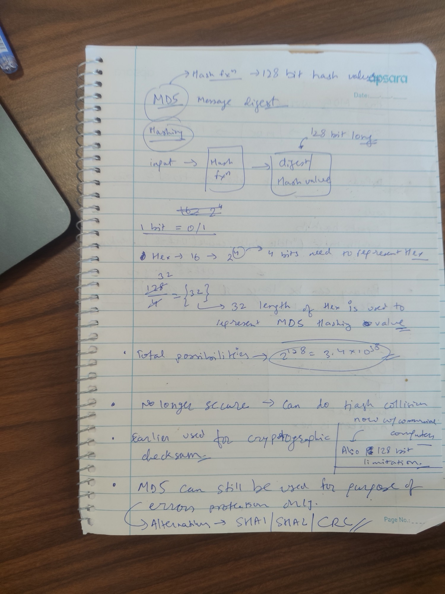
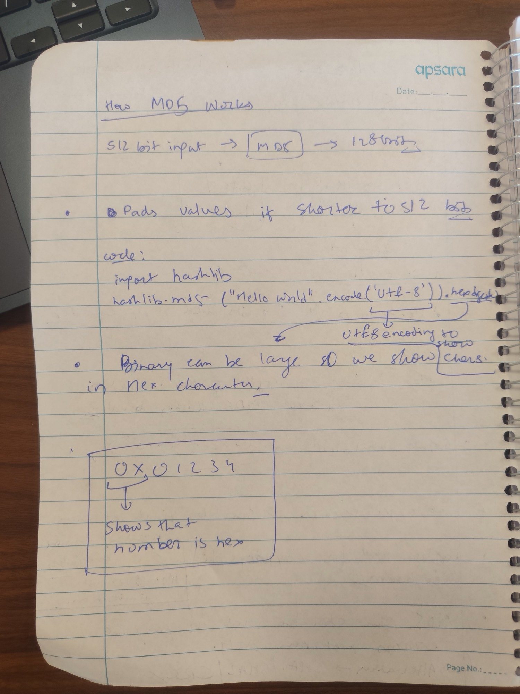
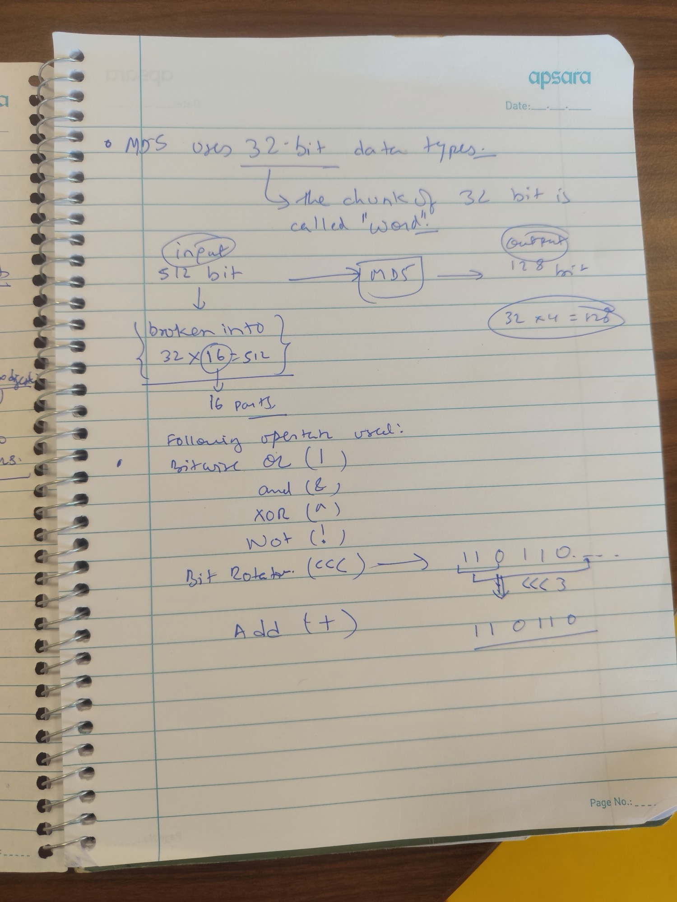

**In one line:** MD5 is a hash function that turns any input into a fixed 128-bit digest (32 hex characters). It is no longer safe for security, but still fine for catching accidental corruption.

## How I think about it

```text
input  ──►  [ hash function ]  ──►  digest / hash value   (always 128 bits long)
```

MD5 stands for **Message Digest 5**. Whatever goes in, a short sentence or a whole file, the same-sized fingerprint comes out. The same input always gives the same digest, and changing even one character gives a completely different one.

Inside, MD5 thinks in **words**: a word is a chunk of 32 bits. It reads its input 16 words at a time (32 × 16 = 512 bits) and its answer is 4 words (32 × 4 = 128 bits).

## Why 128 bits is 32 hex characters

- One bit is a `0` or a `1`.
- Hexadecimal has 16 digits (`0–9`, `a–f`), and 16 = 2⁴, so **one hex digit holds exactly 4 bits**.
- 128 bits ÷ 4 = **32 hex characters**, which is why an MD5 hash is always 32 characters long.
- Binary would be 128 characters long, so hashes are shown in hex. In code, the prefix `0x` (as in `0x01234`) marks a number as hex.

There are 2¹²⁸ ≈ **3.4 × 10³⁸** possible MD5 digests.

## How MD5 works


*From any input to a 128-bit digest: pad, split into blocks, mix each block into four registers.*

> **Correction:** In my notebook I wrote "512 bit input → MD5 → 128 bits" and "pads values if shorter to 512 bits". MD5 accepts input of **any** length and processes it in 512-bit blocks. Padding is always added (even a message that is already exactly 512 bits gets a second block), and it is more than zeros: a `1` bit, then zeros, then the original length.

The simple version of the algorithm:

1. **Pad the message.** Append one `1` bit, then `0` bits until the length is 64 bits short of a multiple of 512, then append the original length as a 64-bit number. The padded message is now a whole number of 512-bit blocks. ("Hello World" is 88 bits, so it gets 1 + 359 + 64 bits and becomes exactly one block.)
2. **Start four registers.** A, B, C and D are 32-bit words with fixed starting values: `0x67452301`, `0xefcdab89`, `0x98badcfe`, `0x10325476`.
3. **For each 512-bit block:**
   1. Split the block into 16 words, `M[0]` to `M[15]`.
   2. Copy A, B, C, D into working variables a, b, c, d.
   3. Run **64 steps**, in 4 rounds of 16. Each round uses its own mixing function of b, c and d:
      - F = `(b & c) | (~b & d)` (rounds 1–16)
      - G = `(b & d) | (c & ~d)` (17–32)
      - H = `b ^ c ^ d` (33–48)
      - I = `c ^ (b | ~d)` (49–64)
   4. Add a, b, c, d back into A, B, C, D (each addition wraps around at 2³²).
4. **Output** A, B, C and D one after another: 4 words × 32 bits = the 128-bit digest.

### One step, up close

![One MD5 step: the round function of b, c and d is added to a, a word of the message M[g] and a constant K[i]. The sum is rotated left by s bits and added to b, giving the new b. The other registers shift along: the new a is the old d, the new c is the old b, and the new d is the old c.](./assets/md5-one-step.svg)
*Every one of the 64 steps uses only the operations from my notes: AND, OR, XOR, NOT, rotate and add.*

Each step mixes one message word into the registers:

```text
new b = b + ((a + f(b, c, d) + M[g] + K[i]) <<< s[i])
new a, new c, new d = d, b, c
```

- `M[g]` is one of the 16 message words; each round reads them in a different order, so every word is used 4 times.
- `K[i]` is a constant for step `i`: the first 32 bits of the fractional part of |sin(i + 1)|, which is just a way to get 64 numbers that look random but anyone can recompute.
- `s[i]` is how far to rotate, which changes from step to step.

### The operations

MD5 only uses cheap operations on 32-bit words:

| Operation | Symbol | What it does |
| --- | --- | --- |
| OR | `\|` | 1 if either bit is 1 |
| AND | `&` | 1 only if both bits are 1 |
| XOR | `^` | 1 if the bits differ |
| NOT | `~` | flips every bit |
| Rotate left | `<<<` | shifts bits left; bits pushed off the end come back in on the right |
| Add | `+` | adds, wrapping around at 2³² |

> **Correction:** I wrote NOT as `!`. In code, bitwise NOT is `~`; `!` means logical not (true/false) in languages like C. The MD5 paper writes it as ¬.

In my notebook, `110110 <<< 3` came out as `110110` again, and that is actually right: the pattern repeats every 3 bits, so rotating by 3 lands on itself. A clearer example: `110100 <<< 3` = `100110`. The leading `110` wraps around to the end.

## Example: hashing in Python

```python
import hashlib

hashlib.md5("Hello World".encode("utf-8")).hexdigest()
# 'b10a8db164e0754105b7a99be72e3fe5'   (32 hex characters)
```

- `.encode("utf-8")` turns the text into **bytes**. Hash functions work on bytes, not on text.
- `hashlib.md5(...)` computes the 128-bit digest (16 bytes).
- `.hexdigest()` shows those 16 bytes as 32 hex characters, because raw binary is long and unreadable.

> **Correction:** I noted that UTF-8 encoding is there "to show chars". It is the other way round: `.encode()` converts characters into bytes for the hash function, and `.hexdigest()` is what turns the result into readable characters.

### MD5 from scratch

The whole algorithm above fits in a short function. This version gives the same answers as `hashlib`:

```python
import math
import struct

def md5(message: bytes) -> str:
    rotate = lambda x, n: ((x << n) | (x >> (32 - n))) & 0xFFFFFFFF
    K = [int(abs(math.sin(i + 1)) * 2**32) & 0xFFFFFFFF for i in range(64)]
    S = [7, 12, 17, 22] * 4 + [5, 9, 14, 20] * 4 + [4, 11, 16, 23] * 4 + [6, 10, 15, 21] * 4
    A, B, C, D = 0x67452301, 0xEFCDAB89, 0x98BADCFE, 0x10325476

    # 1. Pad: a 1 bit (0x80), zeros, then the original length in bits.
    length = len(message) * 8
    message += b"\x80" + b"\x00" * ((56 - (len(message) + 1) % 64) % 64)
    message += struct.pack("<Q", length)

    # 2. Mix each 512-bit block (64 bytes) into A, B, C, D.
    for start in range(0, len(message), 64):
        M = struct.unpack("<16I", message[start:start + 64])
        a, b, c, d = A, B, C, D
        for i in range(64):
            if i < 16:
                f, g = (b & c) | (~b & d), i
            elif i < 32:
                f, g = (d & b) | (~d & c), (5 * i + 1) % 16
            elif i < 48:
                f, g = b ^ c ^ d, (3 * i + 5) % 16
            else:
                f, g = c ^ (b | ~d), (7 * i) % 16
            f = (f + a + K[i] + M[g]) & 0xFFFFFFFF
            a, d, c = d, c, b
            b = (b + rotate(f, S[i])) & 0xFFFFFFFF
        A, B, C, D = [(x + y) & 0xFFFFFFFF for x, y in zip((A, B, C, D), (a, b, c, d))]

    # 3. The digest is A, B, C, D written out byte by byte, little-endian.
    return struct.pack("<4I", A, B, C, D).hex()

md5(b"Hello World")  # 'b10a8db164e0754105b7a99be72e3fe5'
```

MD5 stores numbers little-endian (least significant byte first), which is why the code uses `<` in `struct`.

## Is MD5 still safe?

- **Not for security.** Researchers can now create **collisions**, two different inputs with the same MD5 digest, in seconds on an ordinary computer. Anything that relies on MD5 to stop tampering (signatures, certificates, password storage) can be fooled.
- **The 128-bit size is a limit too.** Because of the birthday paradox, a collision is expected after about 2⁶⁴ tries, not 2¹²⁸, which is too few for a modern security hash.
- **It was once used as a cryptographic checksum**, to prove a file had not been tampered with.
- **It is still fine for error detection**: spotting accidental corruption in a download or a copied file, where nobody is trying to cheat.

> **Correction:** I listed the alternatives as SHA1 / SHA2 / CRC. SHA-1 is broken as well: the first practical collision was published in 2017. For security, use **SHA-256** (from the SHA-2 family) or **SHA-3**. CRC is only for catching accidental errors, like MD5 today, and gives no security at all.

## Further explanation

- Video: [How the MD5 hash function works (from scratch)](https://www.youtube.com/watch?v=5MiMK45gkTY) by RareSkills walks through the algorithm step by step.

## My notebook pages

The handwritten pages this note was written from, kept as they are, corrections and all. Click a page to open it full size.

<details>
<summary>Show the three notebook pages</summary>


*Page 1: what MD5 is, hex length, and why it is broken.*


*Page 2: padding, the Python example, and hex notation.*


*Page 3: words, blocks and the operations.*

</details>

## Revision

### Key takeaways

- MD5 maps any input to a 128-bit digest, written as 32 hex characters (4 bits per hex digit).
- It pads the message to whole 512-bit blocks, splits each block into 16 32-bit words, and mixes them into four registers over 64 steps.
- Every step uses only AND, OR, XOR, NOT, rotate-left and addition modulo 2³².
- MD5 is broken for security because collisions are practical. Use SHA-256 or SHA-3 for security, and keep MD5 or CRC for spotting accidental corruption only.

### Check yourself

<details>
<summary>Why is an MD5 hash always 32 characters long?</summary>

The digest is 128 bits, and each hex digit holds 4 bits (16 = 2⁴), so 128 ÷ 4 = 32 hex characters.

</details>

<details>
<summary>A message is exactly 512 bits long. How many 512-bit blocks does MD5 process?</summary>

Two. Padding is always added: a 1 bit, zeros, and a 64-bit length, so a 512-bit message becomes 1024 bits.

</details>

<details>
<summary>What does <code>.encode("utf-8")</code> do before hashing, and what does <code>.hexdigest()</code> do after?</summary>

`.encode()` turns text into bytes, because hash functions only work on bytes. `.hexdigest()` turns the 16-byte digest into 32 readable hex characters.

</details>

<details>
<summary>What is <code>110100 &lt;&lt;&lt; 3</code> as a 6-bit value?</summary>

`100110`. The first three bits `110` move to the end.

</details>

<details>
<summary>You need to check a download was not corrupted on a flaky network. Is MD5 acceptable? What if an attacker could swap the file?</summary>

For accidental corruption, yes. If someone could tamper with the file, no: use SHA-256, because MD5 collisions can be created on purpose.

</details>

## History

- 2026-10-27: First notes, from three notebook pages on MD5 and the RareSkills video; added the step-by-step algorithm, a from-scratch implementation and corrections. The original pages are kept under [My notebook pages](#my-notebook-pages).
