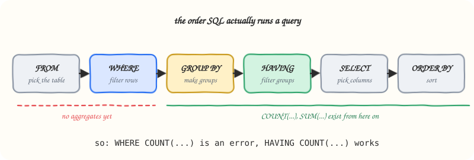

**In one line:** `WHERE` filters rows before they are grouped; `HAVING` filters groups after their aggregates are calculated.

Use `HAVING` when you need to filter a group of rows based on an aggregate value, such as a count, total, or average. `WHERE` and `HAVING` often appear in the same query, but they work at different stages:

- `WHERE` filters individual rows before they are grouped.
- `GROUP BY` forms groups from the remaining rows.
- `HAVING` filters those groups after an aggregate has been calculated.


*The order SQL evaluates a query, which is why aggregate conditions belong in `HAVING`.*

## Example: candidates with every required skill

Suppose `candidates` has one row per candidate skill. To find candidates who know Python, Tableau, and PostgreSQL, first keep only those three skill rows. Then group them by candidate and retain groups containing all three distinct skills.

```sql
SELECT candidate_id
FROM candidates
WHERE skill IN ('Python', 'Tableau', 'PostgreSQL')
GROUP BY candidate_id
HAVING COUNT(DISTINCT skill) = 3
ORDER BY candidate_id;
```

### How the query works

1. `WHERE skill IN (...)` removes skills that are not required for this role, such as `R` or `SQL Server`.
2. `GROUP BY candidate_id` collects each candidate's remaining skill rows into one group.
3. `COUNT(DISTINCT skill)` counts the different required skills in each candidate's group.
4. `HAVING ... = 3` keeps only candidates with all three required skills.
5. `ORDER BY candidate_id` returns the qualifying candidates in ascending ID order.

## When to use this pattern

Use this pattern when a requirement means “has all of these values,” such as a customer who bought every product in a set or a student who completed every required course. Change the list in `IN (...)` and the number in `HAVING` together so that the count matches the number of required values.

## Common mistakes

- Do not use `WHERE COUNT(...)`: `WHERE` runs before aggregate values exist. Put aggregate conditions in `HAVING`.
- Use `COUNT(DISTINCT skill)` when duplicate skill rows are possible; `COUNT(skill)` could make a candidate appear to have more required skills than they actually do.
- `HAVING COUNT(DISTINCT skill) = 3` is correct here only because there are three required skills. If the required list changes, update the count too.

## Practice

- [001 · Data Science Skills](../../practice/sql/001-data-science-skills.md): candidates who have every required skill.
- [002 · Histogram of Tweets](../../practice/sql/002-histogram-of-tweets.md): two levels of aggregation with a CTE.

## Revision

### Key takeaways

- `WHERE` runs before `GROUP BY`, so it can only see individual rows.
- `HAVING` runs after `GROUP BY`, so it is where conditions on `COUNT`, `SUM` or `AVG` go.
- "Has all of these values" is `WHERE x IN (...)` + `GROUP BY` + `HAVING COUNT(DISTINCT x) = n`.
- Use `COUNT(DISTINCT ...)` whenever duplicate rows could inflate a count.

### Check yourself

<details>
<summary>Why is <code>WHERE COUNT(skill) = 3</code> an error?</summary>

`WHERE` is evaluated before rows are grouped, so no aggregate exists yet. Move the condition to `HAVING`.

</details>

<details>
<summary>A candidate has the row (123, 'Python') twice. What does <code>COUNT(skill)</code> return compared with <code>COUNT(DISTINCT skill)</code>?</summary>

`COUNT(skill)` counts both rows, so Python is counted twice; `COUNT(DISTINCT skill)` counts it once. Only the distinct count answers "how many different required skills".

</details>

<details>
<summary>The role now needs four skills. What two things must change in the query?</summary>

Add the fourth skill to the `IN (...)` list and change `HAVING COUNT(DISTINCT skill) = 3` to `= 4`.

</details>

## History

- 2026-10-04: First notes, from the Data Science Skills exercise.
- 2026-10-27: Moved into `notes/sql/`; added the evaluation-order diagram, practice links and the revision block.
