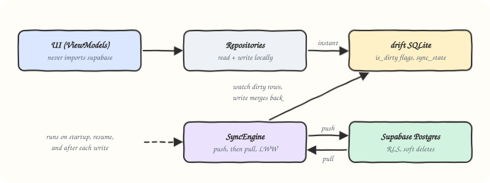

This is an engineering prototype, not a production medical system or patient-facing
service. The case study focuses on offline-first storage, synchronization boundaries,
and the limits that still need validation.

## Architecture Overview

The app follows a strict three-layer data model:

ViewModels and repositories never import `supabase_flutter`. All vitals logging completes against drift immediately. The SyncEngine observes dirty rows and remote deltas, then writes reconciliation results back into drift.

## What's Built

- **Auth & onboarding**: Supabase Auth sign-in and sign-up with patient onboarding and profile editing; the caretaker flow is UI only
- **Vitals logging**: Blood pressure, blood glucose, weight, and fluid intake with add, edit, soft delete, summaries, and charts
- **Medications**: A locally seeded catalogue plus per-dialysis-day medication schedules
- **Remote schema**: Postgres tables with RLS, soft deletes, and `updated_at` triggers
- **Local persistence**: drift database mirroring remote schema plus `is_dirty` flags and a `sync_state` cursor table
- **Sync engine**: Generic push-then-pull with last-write-wins across seven tables, triggered on app startup, resume, connectivity restoration, and a two-second debounce after writes
- **Sync gates**: InitialSyncGate blocks the UI until first online pull; sign-out wipes the entire local database

## What's Next

- **Fix the suite**: Repair the five failing tests and add regression coverage for the history grouping and daily fluid statistics rules
- **Validate against a real backend**: Exercise offline writes, reconnect, and conflicts against a local Supabase stack, then add CI that runs analysis, tests, and migration checks
- **Sync status and retry**: Show pending and failed rows, with durable retry and backoff
- **Caretaker access**: Design the authorization model before building linking, since row-level security is currently patient-owner-only
- **More entities**: Lab results, symptoms, and appointments from the broader schema plan, each registering with the existing SyncEngine
