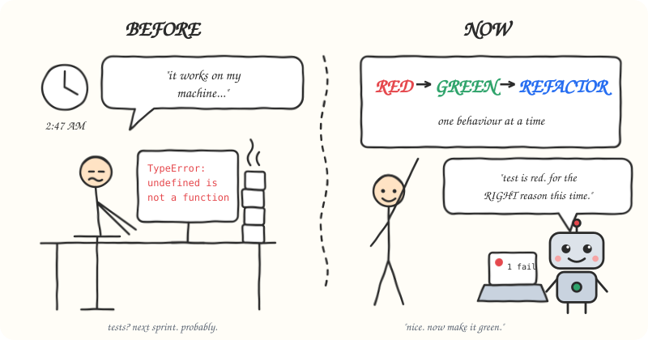
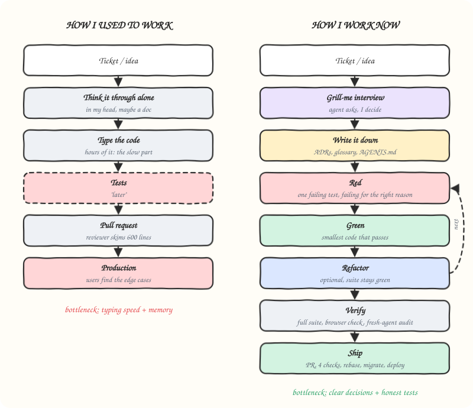
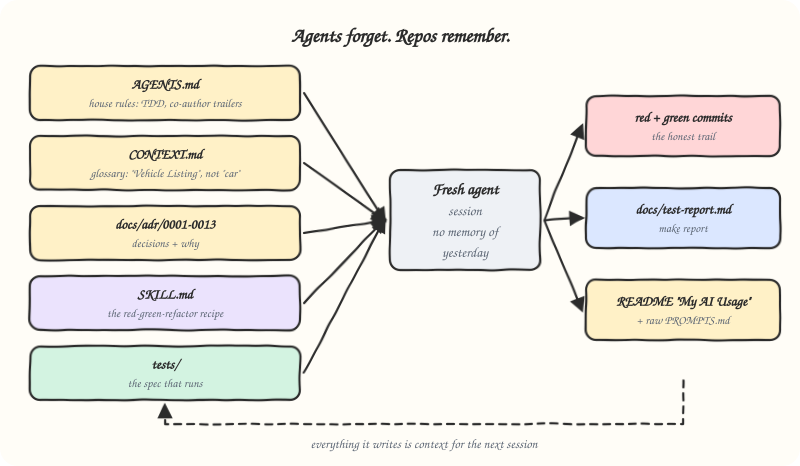
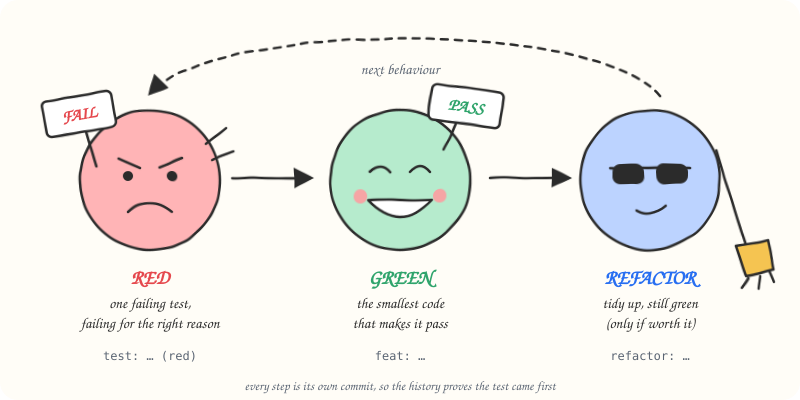
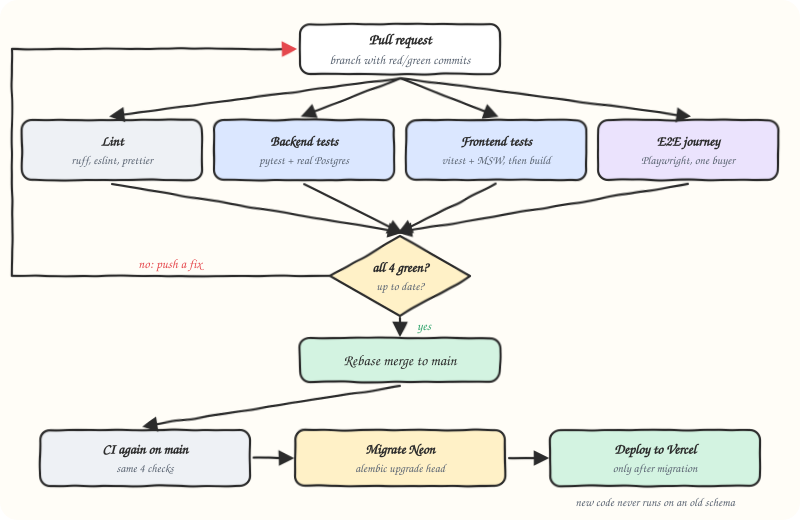
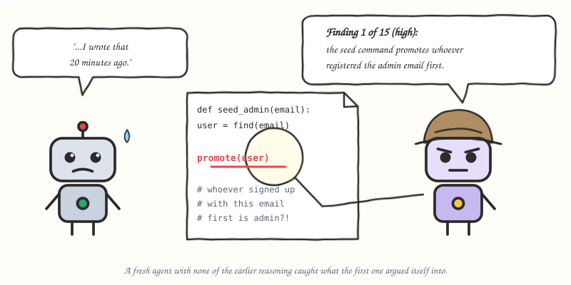
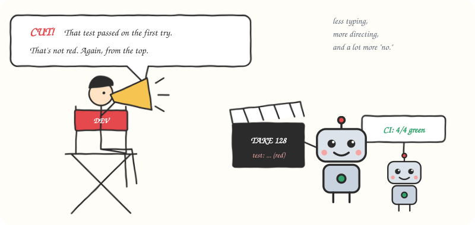

*The same job, two eras. The coffee count is the only metric that went down. Illustration by the author.*

## TL;DR

I built a [car dealership inventory system](/projects/car-dealership-inventory) (FastAPI, PostgreSQL, React, deployed on Vercel and Neon) over a few days with AI coding agents doing most of the typing. The agents were not the interesting part. The workflow around them was:

1. **Get interviewed** before any code exists. The agent asks one question at a time and recommends an answer; I make the call.
2. **Write the decisions down** in the repo, because the next agent session remembers nothing.
3. **Build one behaviour at a time, test first**: a red commit, a green commit, sometimes a refactor commit.
4. **Let machines verify**: real database in tests, four required CI checks, rebase-only merges so the red commits survive.
5. **Get a second opinion** from a fresh agent that never saw the first one's reasoning.

The result: about 320 commits, 127 of them failing tests committed *before* the code that made them pass, 221 automated tests, 98% backend coverage, and a public [live demo](https://car-dealership-inventory-umber.vercel.app). This article is about how that loop works and what it changed about my job.

🔗 [**Source code on GitHub**](https://github.com/SinghChinmayy/Kata-Car-Dealership-Inventory-System)

## How we used to work

For most of the short time I have been writing software, the loop looked like this: read the ticket, think it through alone, then spend hours typing. Tests came "later", which usually meant "after the bug report". The pull request was 600 lines, so the reviewer skimmed it. Edge cases were discovered by users.

That loop made sense when **typing was the bottleneck**. Writing code was slow, so you thought about it in your head while you typed, and you saved effort wherever you could. Tests felt like a tax on the expensive part.


*The steps did not get fewer. The slow one moved from typing to deciding.*

AI agents broke that assumption. An agent can produce a working endpoint, its migration and its tests in the time it takes me to read them. **Typing is now nearly free. Wrong code is not.** An agent will confidently write 400 lines that solve a slightly different problem from the one you have, and it will write tests that agree with it.

So the bottleneck moved. It is now:

- **Clear decisions**: does the agent know exactly what "done" means, including the edge cases?
- **Honest verification**: is there something that fails when the code is wrong, other than me squinting at a diff?

Everything in the workflow below exists to make those two things cheap.

## Step 1: Get grilled before you build

Before each feature I ask the agent to **interview me**. One question at a time, walking the design tree depth-first, and for every question it gives its own recommended answer. I accept it, change it, or say "explain that like I'm five".


*The grill-me interview: one question at a time, each with a recommended answer. I make the call.*

A real one from the search feature looked like this:

> <span class="callout-label">From the interview · Question 1</span>
>
> **How should the make and model search text match?**
>
> - **Contains (recommended)**: case-insensitive substring, `ILIKE '%term%'` with `%` and `_` escaped. "xuv" finds XUV700, and so does "700".
> - Prefix only
> - Exact match

I picked the recommendation. But notice the detail hiding in it: *with `%` and `_` escaped*. Without that, a user searching for `%` matches every car in the database. That was not in my plan. Because the decision was written down in question 1, it got its own red/green cycle later, and the bug never existed.

Why this works better than "here is the ticket, go":

- **The agent surfaces the edge cases**, because it has seen thousands of systems fail in the same ways. Concurrency, blank input, inverted price ranges, deleted records, who is allowed to do what.
- **I still own every decision.** The recommendation is a default, not a verdict. For purchases, I chose to let administrators buy cars too, and the architecture decision record was updated to match.
- **One question at a time** stops the agent from dumping a 30-point plan that I approve without reading.

I keep this interview as a reusable skill called [`grill-me`](/agent-skills#grill-me), so I can start it in any project by saying "grill me". You can [install it](#install-the-skills) too.

## Step 2: Write it down, because agents forget

Every agent session starts with no memory of yesterday. If a decision only lives in a chat log, it is gone. So the repository *is* the memory:


*Every session starts from the files, not from yesterday’s chat.*

| File | What it holds | Why the agent needs it |
| --- | --- | --- |
| `AGENTS.md` | House rules: test first, co-author trailers on AI commits, keep raw chat logs | Read automatically at the start of every session |
| `CONTEXT.md` | A glossary: "Vehicle Listing", not "car"; "Stock Quantity", not "inventory" | Stops the agent inventing five names for one thing |
| `docs/adr/` | 13 architecture decision records: why UUIDs, why soft delete, why INR only | Stops the agent re-arguing settled decisions |
| `SKILL.md` | The red-green-refactor recipe (next section) | Turns "please do TDD" into a procedure |
| The tests | The specification that actually runs | The only part that cannot drift from the code |

The glossary looks like overkill until you watch an agent call the same table `vehicles`, `cars` and `inventory` in one afternoon. After that it feels essential.

## Step 3: Red, green, refactor, one behaviour at a time

This is the heart of it. I packaged my rules as a **skill**: a markdown file the agent loads whenever it implements a feature. The core of it fits on a sticky note:


*Red, green, refactor. Each step is its own commit.*

> **🔴 Red**: write ONE failing test for one behaviour. Run it. It must fail on an assertion, not on an import error or a typo. Commit `test: <behaviour> (red)`.
>
> **🟢 Green**: write the minimum code that makes it pass. Nothing extra. Run the *full* suite. Commit `feat: <behaviour>`.
>
> **🔵 Refactor** (optional): same behaviour, cleaner structure, suite still green. Commit `refactor: <what>`.
>
> **Rules**: one behaviour per cycle. A new test that passes on its first run is not red. Never squash or rewrite history.

Each phase is its **own commit**, so the git history proves the test came first. Here is what that looks like for the "My purchases" feature, straight from `git log`:


*Real commits from the My purchases feature, read straight from git log.*

Why this matters *more* with AI than without it:

- **"Fails for the right reason" is the agent's lie detector.** If I ask an agent to write a test and the code together, the test tends to agree with whatever the code does. Forcing the test to fail first, on the expected assertion, proves the test can actually catch the bug.
- **A test that passes on the first try is a red flag.** Either the behaviour already exists, or the test is not testing anything. For rules the framework already enforced (like request validation) the agent wrote a *guard test* instead, committed without the `(red)` label, with a note explaining why it could not start red.
- **Small cycles keep the diff reviewable.** I can read a 30-line test and a 20-line implementation. I cannot meaningfully review 600 lines, no matter who wrote them.

### The cycle where red earned its keep: concurrency

The best example is the purchase endpoint. The requirement sounds trivial: buying a car reduces stock by one. The interview asked the uncomfortable question (*what if 20 people buy at once?*), and the skill told the agent how to tell that story honestly:


*The naive version oversold. One conditional UPDATE fixed it.*

1. **Red**: a test fires 20 simultaneous purchases at a listing with 5 units, each on its own database session, and expects exactly 5 successes, 15 `409 Conflict` responses, and a final quantity of 0.
2. **Green, deliberately naive**: read the quantity, subtract one, write it back. The agent committed this *on purpose*, and the test failed: every buyer read "5 in stock" before anyone wrote, and the shop oversold.
3. **Fix**: one atomic statement, with the purchase record inserted in the same transaction.

```sql
UPDATE vehicle_listings
SET quantity = quantity - 1
WHERE id = :id AND quantity > 0 AND deleted_at IS NULL
RETURNING ...
```

Seeing the oversell reproduce made the atomic statement concrete instead of theoretical. It also taught me a testing detail I would have missed: the concurrency test only proves something if each request gets its own session from a pool larger than the number of buyers. Otherwise the requests quietly run one at a time and the naive code passes.

## Step 4: Let machines do the verifying

Agents are confident. Confidence is not evidence. So nothing reaches production on anyone's word, mine included:


*Four required checks guard main. Migrations run before the deploy, never after.*

- **Tests hit a real PostgreSQL** in a throwaway container (Testcontainers), not mocks. Half of the interesting bugs (wildcards, row locks, trigram search, a migration ID longer than Alembic's 32-character column) only exist in the real database.
- **Four required checks** on every pull request: lint, backend tests (which fail below 95% coverage), frontend tests plus build, and one end-to-end Playwright journey where an admin adds a car and a buyer purchases it.
- **Rebase-only merges.** A squash merge would fold each failing-test commit into the code that fixed it and erase the evidence.
- **Migrate, then deploy.** On `main`, CI applies database migrations first and deploys only if they succeed, so new code never runs against an old schema.

A funny moment: I created the branch protection rules myself in GitHub's UI and asked the agent to verify them through the API. Two settings had silently not saved. The required-checks list was empty, so failing CI would not have blocked a merge, and squash merging was still allowed. The thing that protects the workflow needed protecting too.

The agent also drove the real app in a browser before calling UI work done. Component tests passed, but the browser showed filter buttons overflowing at mid-size widths and "Log out" wrapping on phones. Tests check behaviour; eyes check layout. You need both.

## Step 5: Ask a fresh agent to break it

After the frontend was done, I started a **second agent with no memory of the first one's reasoning** and asked for a read-only audit of the whole codebase. It came back with 15 ranked findings.


*A reviewer with no stake in the original argument found the worst bug.*

The most serious one was in code the first agent had written *that same session*: the command that creates the first administrator would promote whoever had registered the configured admin email first. If an attacker signed up with that address before the seed ran, they became the admin.

The first agent had argued itself into that design. The second one had no stake in the argument. We went through the findings one at a time, I chose each fix, and every fix went through the same red/green cycle. Treat the second agent like a code reviewer who joined the team today: no context is a feature.

## What actually changed about my job


*Who owns what in the loop.*

| | Before | Now |
| --- | --- | --- |
| Where my time goes | Typing and remembering syntax | Deciding, reviewing, saying "no" |
| Hardest skill | Knowing the framework | Knowing what you actually want, precisely |
| Tests | A tax, written after | The spec, written first, and the agent's leash |
| Documentation | A chore nobody reads | Context the next agent session *will* read |
| Code review | Skimming a big diff | Reading one small test and one small change |
| Biggest risk | Too slow | Too fast in the wrong direction |

The honest summary: **I write far less code and make far more decisions.** The agent is a fast, tireless, overconfident pair programmer. The workflow is what turns that into something I trust.

## What went wrong (because something always does)

The workflow did not make the agents perfect. It made their mistakes *visible early*:

- **A migration ID was too long** for Alembic's version column. The first test run caught it.
- **A commit slipped through with a formatting error.** It was fixed with a new commit, not a history rewrite, and the agent wrote a script that runs every check before committing.
- **The deploy bundle included `.env` files**, because local Vercel builds ignore `.vercelignore`. A local build before the first deploy caught it.
- **A test broke coverage reporting**, which let one commit go in with a stale test report.

None of these reached users. That is the whole point: the agent will be wrong regularly, so build a loop where being wrong is cheap.

## Try it in your project

I have generalized the TDD skill so it works in any language or framework: it discovers your test runner instead of assuming pytest, and the concurrency recipe applies to any shared-state write (stock, balances, seat bookings). It and the `grill-me` interview are open source in [SinghChinmayy/agent-skills](https://github.com/SinghChinmayy/agent-skills), and you can install them with one command each.

### Install the skills

Run these from your project. They use the open [`skills`](https://github.com/vercel-labs/skills) installer, which works with Claude Code, Codex, Cursor, Copilot and most other agents, and asks which ones to install for:

```bash
npx skills add SinghChinmayy/agent-skills --skill tdd-red-green-refactor
npx skills add SinghChinmayy/agent-skills --skill grill-me
```

Add `-g` to install for every project on your machine instead of just this one. To skip the prompts and install straight into Claude Code:

```bash
npx skills add SinghChinmayy/agent-skills --skill tdd-red-green-refactor --skill grill-me -g -a claude-code -y
```

No Node on the machine? A skill is just a folder with a `SKILL.md` file, so this works too (Claude Code shown):

```bash
mkdir -p ~/.claude/skills/tdd-red-green-refactor && curl -fsSL https://raw.githubusercontent.com/SinghChinmayy/agent-skills/main/skills/engineering/tdd-red-green-refactor/SKILL.md -o ~/.claude/skills/tdd-red-green-refactor/SKILL.md
```

The rest of my skills (database planning, scoped builds, terse replies) are on the [Agent Skills](/agent-skills) page.

### The minimum setup

1. **Add an `AGENTS.md`** (or `CLAUDE.md`) with your rules: test first, one behaviour per commit, never squash.
2. **Install the TDD skill** (above) and tell the agent to use it for every feature or bug fix. The [project-specific original](https://github.com/SinghChinmayy/Kata-Car-Dealership-Inventory-System/blob/main/.agents/skills/tdd-red-green-refactor/SKILL.md) is still in the dealership repo if you want to see where it started.
3. **Start each feature with an interview.** Say "grill me" with the `grill-me` skill installed, or ask the agent to question you one item at a time, with a recommended answer for each.
4. **Write decisions down** as short ADRs and a glossary as you go.
5. **Protect `main`**: required CI checks, rebase or merge commits only, no bypass for yourself.
6. **Run a fresh-agent audit** before you call anything done.
7. **Add a co-author trailer** to AI-assisted commits (for example `Co-authored-by: Claude <noreply@anthropic.com>`), so the history is honest about who did what.


*Less typing, more directing.*

I am early in my career, and this is one project, so take it as field notes rather than a law. But the shift felt real: the job moved from *writing* code to *directing and verifying* it. The tools will keep changing. Writing the test first, writing the decision down, and trusting evidence over confidence are the parts I expect to keep.

*The full project, including every architecture decision, the test report, and the raw AI chat logs, is in the [repository](https://github.com/SinghChinmayy/Kata-Car-Dealership-Inventory-System). You can read the case study on the [project page](/projects/car-dealership-inventory).*
